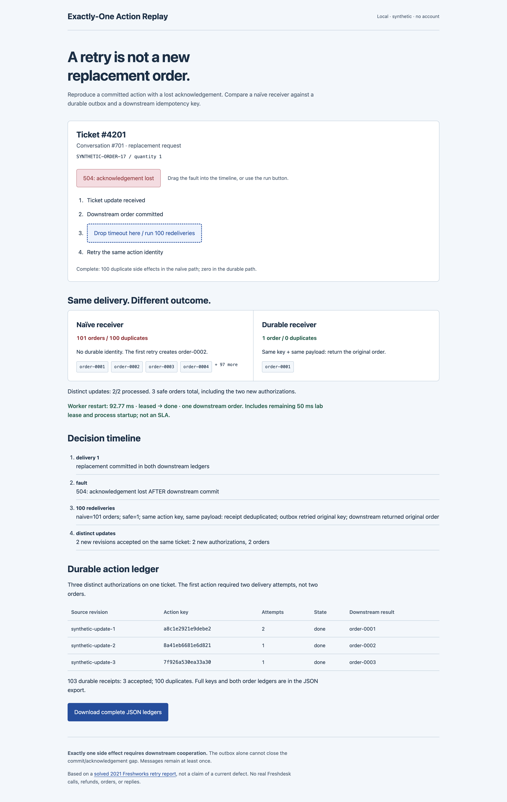
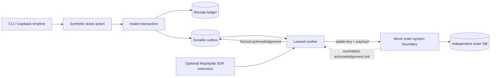

# Freshdesk Exactly-One Action Replay

A local replay showing how ticket-webhook retries can avoid duplicate downstream actions.

## The problem

Support teams connect ticket automations to order systems. If an action commits but its acknowledgement is lost, retrying the webhook can create a second replacement order unless both receiver and downstream service preserve the operation's identity.

- [A solved Freshworks Community report](https://community.freshworks.com/ticketing-agent-productivity-11362/webhook-called-twice-5min-apart-21958) (2021-08-17; staff answer 2021-08-19) describes the same ticket webhook arriving twice: Freshworks attributed the second call, five minutes later, to a retry after a 504 timeout. This is historical retry evidence, not a current double-refund defect.
- [Stripe's idempotent-request documentation](https://docs.stripe.com/api/idempotent_requests) (undated; checked 2026-11-14) explains that retrying after connection errors can create duplicate objects or updates without idempotency, and that API v1 returns the saved result for the same key.

This synthetic replay compares a naïve handler with durable intake, an outbox, leases and a mock downstream idempotency contract; it demonstrates exactly-one effects under that contract, not universal exactly-once delivery or live Freshdesk behavior.

**100 injected redeliveries: 100 duplicate effects naïvely; zero with durable
identity and downstream idempotency. Two distinct updates still execute.**

Python 3.11+; no runtime packages, credentials, account or network required:

```sh
python3 -m replay demo
```

Actual captured output ([complete capture](evidence/demo.txt)):

```text
Freshdesk Exactly-One Action Replay
Synthetic only; no Freshdesk account, real orders, refunds, or replies.
Fault: order committed, acknowledgement timed out (synthetic 504).
Injected redeliveries: 100
Duplicate downstream effects: naive=100 safe=0
Replay orders: naive=101 safe=1
Distinct updates processed: 2/2
Safe total orders: 3 (1 replayed action + 2 distinct updates)
Restart recovery: 107.59 ms; leased -> done; downstream orders=1
```

The recovery number varies. It includes the remaining **50 ms lab lease**, a fresh
Python process and reconciliation, measured after the crashed child exits. It is
one local observation, not a benchmark or an SLA. The 100 redeliveries are immediate
lab injections, not a claim about Freshdesk's current retry schedule.

## Try the ticket timeline

```sh
python3 -m replay.web
# Open http://127.0.0.1:8765 ; Ctrl-C stops the server.
```

Drag **504: acknowledgement lost** into the ticket timeline, or focus the run
button and press Enter. Both execute real local SQLite writes, 100 redeliveries,
two distinct updates and a real worker-process death/restart. Inspect the action
ledger and download the full JSON with both downstream ledgers and 103 receipts.
Every run uses fresh temporary databases, deleted after the report is assembled.
The server binds only to loopback and serves three fixed assets; do not expose it.



[Mobile keyboard-run capture](evidence/mobile.png)

## What's hard here

- **The uncertain commit.** An outbox prevents lost intent, not a duplicate remote
  commit. The downstream system must atomically bind the same key to the same
  payload and return its original result after an acknowledgement timeout.
- **Dedupe without data loss.** Ticket ID alone discards legitimate updates.
  Tenant + ticket + conversation + immutable source revision + action identify
  the synthetic authorization; a changed payload under that identity is rejected.
- **Recovery without stale ownership.** Durable, expiring leases survive process
  death; claim tokens fence late workers. No SQLite transaction spans a downstream
  call. Concurrent intake and claims are tested with real SQLite connections.

## Architecture



`replay/model.py` validates and hashes a synthetic envelope. `store.py` owns
transactional acceptance and claims. `orders.py` simulates a downstream atomic
idempotency contract in a separate database. `worker.py` owns one delivery attempt.
`scenario.py` compares handlers; `recovery.py` kills a child after its remote commit
with exit code 75 and starts a new worker. The HTTP UI uses the same runner as CLI.

## Design decisions

- Canonical JSON identity hashed with SHA-256; delivery IDs and mutable payloads
  are not identities. Same key/different payload fails closed on both sides.
- SQLite `BEGIN IMMEDIATE`, unique keys and short transactions, not distributed
  locks. Token-conditional updates reject stale local completions.
- At-least-once delivery with exactly-one downstream effect **under the simulator's
  atomic idempotency contract**. This is not universal exactly-once messaging.
- The worker retries acknowledgement timeouts only. Other errors propagate and
  leave the lease to expire; production needs explicit error classification,
  backoff, attempt budgets and reconciliation, rather than a generic retry loop.

[DESIGN.md](DESIGN.md) covers the three hardest decisions, rejected alternatives,
failure behavior, security and what changes at 100× scale.

## Tests and CI

```sh
python3 -m venv .venv
.venv/bin/python -m pip install -r requirements-dev.txt
.venv/bin/python -m pytest -q
.venv/bin/python -m replay demo
```

61 core pytest cases exercise validation, tenant/update identity, durable acceptance,
concurrent duplicates/claims, payload conflicts, transaction rollback, stale fencing,
ack loss, actual process death, metrics and loopback HTTP contracts. All use local
synthetic data and real SQLite. Installing test tooling needs a package index or
cache; after that, tests and demo run without network or provider keys.

[CI](.github/workflows/ci.yml) runs tests and the demo on Python 3.11 and 3.13.
No hosted CI run is claimed. [EVIDENCE.md](EVIDENCE.md) records observed local runs
and clean-clone verification.

## Optional Replaylab extension

`extensions/replaylab_freshdesk.py` consumes the separately authored Replaylab
public Python SDK; it does not vendor its implementation. Core demo/CI do not
require Replaylab. If you already have Replaylab installed, run:

```sh
python3 -m extensions.replaylab_freshdesk
```

Or, with a local source checkout (SDK source is standard-library-only):

```sh
export REPLAYLAB_SRC=/path/to/replaylab/src
PYTHONPATH="$REPLAYLAB_SRC" python3 -m extensions.replaylab_freshdesk
PYTHONPATH="$REPLAYLAB_SRC" .venv/bin/python -m pytest integration -q
```

Tested with Replaylab commit `45cb064407515881ccd5196f2fe056aa974ea8d5`:
three delivery boundaries recorded, three replayed, zero additional effects
during trace replay; two original downstream orders (one retried action, one new
update). This illustrates **trace replay**, not webhook redelivery: trace replay
substitutes recorded results, while the core experiment actually sends repeated
actions. Agentprobe's conversation scoring is not used; this fault is deterministic.

## Limitations

- Freshdesk tickets, conversation identity and actions are synthetic. The envelope
  is a demo contract, **not a documented Freshdesk webhook schema**. There is no
  Freshdesk authentication, live receiver, ticket read or Freddy integration.
  [Public API docs](https://developers.freshdesk.com/api/) describe optional future
  reads at `GET /api/v2/tickets/{id}` and `/api/v2/tickets/{id}/conversations`;
  an account/API key and plan-specific limits would apply.
- Revision is a caller-supplied immutable authorization identifier. A mutable
  `updated_at` fetched during redelivery can identify a different snapshot. Persist
  the original event snapshot; do not refetch and invent a new identity on retry.
- Distinct revisions are distinct authorizations here. Two revisions authorizing
  the same real refund need a separate business-operation/approval key. This lab
  does not prevent semantic duplication across independently keyed authorizations.
- The mock downstream service durably honors keys for its database lifetime. Real
  providers must offer an equivalent contract with sufficient key retention. If
  they do not, reconcile an uncertain commit instead of claiming exactly once.
- No real refunds, replacements, customer replies or LLM calls. No paid providers,
  platform internals, public deployment, per-ticket ordering or distributed-worker
  performance claims. The naive handler is intentionally unsafe, not Freshdesk code.

## For Freshworks engineers

Use this as a deterministic integration example or regression fixture for app
builders whose ticket automations call order systems. The useful seam is the
receiver/action adapter, not Freddy internals or an aggregate dashboard.

To upstream the example: define an immutable authorization key in a documented
payload, acknowledge only after transactional acceptance, propagate the key to the
action provider, and add the commit-before-ack crash case to the integration suite.
Substitute read-only ticket/conversation snapshots from the public API only after
account access is granted. Document provider key TTL, conflict handling and
reconciliation for providers without keys. No claim is made that Freshworks needs
to replace its native analytics or change its webhook retry policy.

## Roadmap

Production concerns deliberately not built: authenticated webhook ingestion,
PostgreSQL worker claims, tenant quotas, finite backoff/dead-letter review,
business-level approval keys and provider-specific reconciliation adapters.

MIT. Original implementation and synthetic fixtures by Goutham Madineni.
